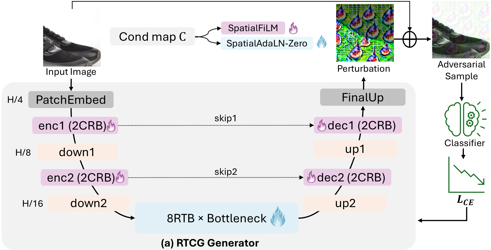

<div align="center">

# Go with the Flow: Generative Targeted Attacks via Restoration Transformers

**RTCG** — **R**estoration **T**ransformer-based **C**onditional **G**enerator

Md Mahabubur Rahman, Hui Zhang, Anjie Peng, Hui Zeng

Southwest University of Science and Technology, Mianyang, China

[](https://www.python.org/)
[](https://pytorch.org/)

[**Paper**](#citation) (coming soon) · [**Checkpoints**](https://drive.google.com/drive/folders/1A1-6uryXixJcQNWuI1w0afUL-jQTK0Bz?usp=drive_link) · [**Test data**](https://www.kaggle.com/c/nips-2017-non-targeted-adversarial-attack)

</div>

---
<p align="center">
  
</p>
## Overview

RTCG is a **multi-target generative attack**. A single generator crafts targeted, transferable adversarial perturbations for any of eight ImageNet target classes in one forward pass.

Existing multi-target generators tend to produce a nearly image-agnostic template for each target. RTCG reduces this *template bias* with two design choices:

- **Restoration-transformer bottleneck.** Eight restoration transformer blocks (RTBs) work at 1/16 resolution. Each block uses channel-wise attention (MDTA) and a gated feed-forward network (GDFN), as in [Restormer](https://github.com/swz30/Restormer). The bottleneck adapts to each image and keeps its spatial layout.
- **Persistent spatial conditioning.** The target is a 2D Stable Diffusion-2 latent. It modulates every block of the encoder, bottleneck, and decoder per pixel. The 8 convolutional residual blocks (CRBs) use **SpatialFiLM**. The 8 RTBs use **SpatialAdaLN-Zero**. This gives 24 modulation sites in total.

<p align="center">
  
  <br>
  <em>Intermediate features of three conditional generators for the same input image. RTCG keeps the layout of the input through its bottleneck while the target is injected at every block.</em>
</p>

## Repository Structure

```
RTCG/
├── models/
│   ├── generator.py                # RTCGenerator: encoder → 8 RTBs → decoder (U-Net)
│   ├── restoration_transformer.py  # RTB (MDTA + GDFN) and conditioned residual block (CRB)
│   └── spatial_modulation.py       # CondEncoder, SpatialFiLM, SpatialAdaLN-Zero
├── train.py              # Train a multi-target generator against a surrogate
├── eval.py               # Generate adversarial examples on the NeurIPS'17 dev set (all 8 targets)
├── inference.py          # Measure targeted ASR of the generated images on victim models
├── inference_jepg.py     # Same as inference.py, with a JPEG-compression defense
├── get_latent.py         # (Optional) Regenerate the class latents with Stable Diffusion 2
├── latents.pth           # Precomputed SD-2 latents for the 8 target classes
├── image_transformer.py  # Training augmentations (two-view transform, random 90° rotation)
├── utils.py              # Data loading, label mapping, target-class sets, victim model zoo
└── environment.yaml      # Conda environment used for the paper
```

> **Note on file names.** `eval.py` *generates* adversarial images. `inference.py` *evaluates* them.

## Installation

Clone the repository:

```bash
git clone https://github.com/<your-username>/RTCG.git
cd RTCG
```

**Option A — exact paper environment (conda).**

```bash
conda env create -f environment.yaml
conda activate RTCG
```

**Option B — minimal install (pip).** This installs only the packages that RTCG imports.

```bash
conda create -n rtcg python=3.11 -y
conda activate rtcg
pip install torch==2.4.1 torchvision==0.19.1 --index-url https://download.pytorch.org/whl/cu124
pip install timm==1.0.11 einops==0.8.0 numpy pandas pillow tqdm

# Only needed to regenerate latents.pth with get_latent.py
pip install diffusers==0.30.3 transformers==4.44.2 accelerate==0.34.2 matplotlib
```

Training requires a CUDA GPU. Generation and evaluation fall back to the CPU, but they are slow there.

## Data Preparation

### Training data: ImageNet-1K

Use the ImageNet-1K (ILSVRC-2012) training set in the standard `ImageFolder` layout, with one subfolder per class:

```
/path/to/imagenet/train/
├── n01440764/
│   ├── n01440764_10026.JPEG
│   └── ...
└── ...
```

By default, `train.py` draws a fixed random subset of **325,000 images** (seed `1111`), as in the paper. Pass `--train_subset_size 0` to train on all images.

### Test data: NeurIPS 2017 dev set

Download the 1,000 test images and their metadata CSV from the [Kaggle competition page](https://www.kaggle.com/c/nips-2017-non-targeted-adversarial-attack). You must sign in and accept the competition rules first. With the [Kaggle CLI](https://github.com/Kaggle/kaggle-api):

```bash
kaggle competitions download -c nips-2017-non-targeted-adversarial-attack
```

Arrange the files exactly like this:

```
data/nips2017_dev/
├── images.csv      # must contain the columns ImageId, TrueLabel, TargetClass
└── images/
    ├── <ImageId>.png
    └── ...         # 1,000 PNG images, 299×299
```

- `eval.py` reads this folder with `torchvision.datasets.ImageFolder`. Therefore `images/` must be the **only** subfolder inside `data/nips2017_dev/`.
- Labels in `images.csv` are 1-indexed (1–1000). The code shifts them to 0–999.
- If your copy names the metadata file differently (for example `dev_dataset.csv`), rename it to `images.csv`.

## Pretrained Checkpoints

Download the trained generators from **[Google Drive](https://drive.google.com/drive/folders/1A1-6uryXixJcQNWuI1w0afUL-jQTK0Bz?usp=drive_link)**. You can also fetch the whole folder from the command line:

```bash
pip install gdown
gdown --folder "https://drive.google.com/drive/folders/1A1-6uryXixJcQNWuI1w0afUL-jQTK0Bz" -O checkpoints
```

The commands in this README assume this layout:

```
checkpoints/
├── res50/model-9.pth   # surrogate: ResNet-50,    input 224×224
└── incv3/model-9.pth   # surrogate: Inception-v3, input 299×299
```

Each file is a plain `state_dict` of `RTCGenerator`. Both surrogates use the same constructor arguments.

<details>
<summary><b>Use the generator from Python</b></summary>

```python
import torch
from models.generator import RTCGenerator

netG = RTCGenerator(cond_channels=4, cond_dim=128, dim=64, n_latent=8, n_heads_latent=8)
netG.load_state_dict(torch.load("checkpoints/res50/model-9.pth", map_location="cpu"))
netG.eval()

latents = torch.load("latents.pth", map_location="cpu")   # {class_id: tensor[4, 64, 64]}

x = torch.rand(4, 3, 224, 224)                    # images in [0, 1], NOT mean/std-normalized
cond = latents[150].unsqueeze(0).expand(x.size(0), -1, -1, -1)   # target 150: sea lion
eps = 16 / 255

with torch.no_grad():
    delta = netG(x, cond, eps=eps)                # ||delta||_inf <= eps
x_adv = (x + delta).clamp(0, 1)
```

</details>

## Quick Start

Evaluate the pretrained ResNet-50 generator in two steps:

```bash
# 1) Generate adversarial examples for all 8 targets (8 × 1,000 images)
python eval.py --model_type res50 \
               --load_path checkpoints/res50/model-9.pth \
               --data_dir data/nips2017_dev \
               --save_dir results/res50

# 2) Measure targeted ASR on the normally trained victims
python inference.py --test_dir results/res50/gan_n8/model-9 --model_t normal
```

For the Inception-v3 generator, use `--model_type incv3`, `--load_path checkpoints/incv3/model-9.pth` and `--save_dir results/incv3`.

> **Windows:** replace the `\` line continuations with `^` (cmd) or `` ` `` (PowerShell), or write each command on one line.

## Training

```bash
# ResNet-50 surrogate (224×224)
python train.py --train_dir /path/to/imagenet/train --model_type res50 --save_dir checkpoints/

# Inception-v3 surrogate (299×299)
python train.py --train_dir /path/to/imagenet/train --model_type incv3 --save_dir checkpoints/
```

Always pass `--train_dir`. Its default value is a local path from our machine.

| Argument | Default | Description |
|:--|:--|:--|
| `--train_dir` | — | ImageNet training folder (`ImageFolder` layout) |
| `--model_type` | `res50` | Surrogate: `res50` (224×224) or `incv3` (299×299) |
| `--eps` | `16` | L∞ budget in pixel units; ε = `eps`/255 |
| `--epochs` | `10` | Number of training epochs |
| `--batch_size` | `8` | Batch size |
| `--lr` | `1e-4` | Adam learning rate, β = (0.5, 0.999) |
| `--train_subset_size` | `325000` | Size of the random training subset; `0` uses all images |
| `--seed` | `1111` | Seed for the subset selection |
| `--label_flag` | `N8` | Target-class set (see [below](#target-classes-and-conditioning-latents)) |
| `--save_dir` | `checkpoints/` | Output root |
| `--start_epoch`, `--load_path` | `0`, `''` | Resume from a saved checkpoint |

## Generating Adversarial Examples

`eval.py` crafts adversarial versions of all 1,000 test images for every target class.

| Argument | Default | Description |
|:--|:--|:--|
| `--data_dir` | — | NeurIPS'17 dev-set folder (see [Data Preparation](#data-preparation)) |
| `--model_type` | `incv3` | Sets the image size: `incv3` → 299, `res50` → 224. Must match the checkpoint's surrogate |
| `--load_path` | — | Generator checkpoint |
| `--save_dir` | `results/ccck` | Output root |
| `--eps` | `16` | L∞ budget in pixel units |
| `--batch_size` | `8` | Batch size |
| `--label_flag` | `N8` | Target-class set |

The adversarial images are projected onto the ε-ball, clamped to [0, 1], and saved as lossless PNG files:

```
results/res50/gan_n8/
├── model-9_t150/images/150_0.png … 150_999.png
├── model-9_t426/images/…
└── …                                  # one folder per target class
```

The folder prefix (`model-9`) comes from the checkpoint file name. Use a separate `--save_dir` for each checkpoint, so that two `model-9.pth` files do not overwrite each other's outputs.

## Evaluating Targeted ASR

`inference.py` counts how many adversarial images each victim classifies as the intended target. It then averages this rate over the eight targets.

```bash
python inference.py --test_dir results/res50/gan_n8/model-9 --model_t normal
```

Pass `--test_dir` **without** the `_t<class>` suffix. The script appends it for each target.

| `--model_t` | Victim models |
|:--|:--|
| `normal` | `incv3`, `vgg16`, `googlenet`, `res50`, `res152`, `dense121` |
| `vit` | `vit_base_patch16_224`, `pit_b_224`, `visformer_small`, `swin_tiny_patch4_window7_224` |
| `robust` | `adv_incv3`, `ens_inc_res_v2`, `res50_sin`, `res50_sin_in`, `res50_sin_fine_in`, `res50_augmix` |
| `all` | `vgg16`, `googlenet`, `incv3`, `res152`, `dense121`, `incv4`, `inc_res_v2`, `adv_incv3`, `ens_inc_res_v2`, `res50_sin`, `res50_sin_in`, `res50_sin_fine_in` |
| *single name* | Any key above, or `vgg19`, `dense201`, `incv4`, `inc_res_v2` |

### Robust victims (manual download)

The Stylized-ImageNet and AugMix ResNet-50 models must be downloaded by hand:

| Key | Name | Source | File |
|:--|:--|:--|:--|
| `res50_sin` | Res-50<sub>SIN</sub> | [texture-vs-shape](https://github.com/rgeirhos/texture-vs-shape) | `resnet50_train_60_epochs-c8e5653e.pth.tar` |
| `res50_sin_in` | Res-50<sub>IN</sub> | [texture-vs-shape](https://github.com/rgeirhos/texture-vs-shape) | `resnet50_train_45_epochs_combined_IN_SF-2a0d100e.pth.tar` |
| `res50_sin_fine_in` | Res-50<sub>FINE</sub> | [texture-vs-shape](https://github.com/rgeirhos/texture-vs-shape) | `resnet50_finetune_60_epochs_lr_decay_after_30_start_resnet50_train_45_epochs_combined_IN_SF-ca06340c.pth.tar` |
| `res50_augmix` | Res-50<sub>AugMix</sub> | [AugMix](https://github.com/google-research/augmix) | `checkpoint.pth.tar` |

Then edit the paths in `load_robust_model()` in `utils.py`, for example:

```python
local_weights = {
    'res50_sin':         'pretrained/resnet50_train_60_epochs-c8e5653e.pth.tar',
    'res50_sin_in':      'pretrained/resnet50_train_45_epochs_combined_IN_SF-2a0d100e.pth.tar',
    'res50_sin_fine_in': 'pretrained/resnet50_finetune_60_epochs_lr_decay_after_30_start_resnet50_train_45_epochs_combined_IN_SF-ca06340c.pth.tar',
    'res50_augmix':      'pretrained/checkpoint.pth.tar',
}
```

## Target Classes and Conditioning Latents

RTCG follows the 8-target protocol of C-GSP and TGAF (`--label_flag N8`):

| ID | Class | ID | Class |
|--:|:--|--:|:--|
| 150 | sea lion | 952 | fig |
| 426 | barometer | 507 | combination lock |
| 843 | swing | 590 | hand-held computer |
| 715 | pickelhaube | 62 | rock python |

`latents.pth` holds one Stable Diffusion-2 latent per target class, as a dictionary `{class_id: tensor[4, 64, 64]}`. **All results in the paper use this file.** You do not need to regenerate it.

`get_latent.py` shows how the file was made:

- It uses Stable Diffusion 2 (base), DDIM with 25 steps, guidance scale 7.5, seed 0, and a class-specific prompt.
- It uses rejection sampling. A latent is kept only when ResNet-152 classifies its decoded image as the target class.
- It stores the latent after the 1/0.18215 VAE scaling. Accepted images are saved to `selected_images/`.

<details>
<summary><b>Regenerating the latents (optional)</b></summary>

1. Download the diffusion model:
   ```bash
   huggingface-cli download Manojb/stable-diffusion-2-base
   ```
2. Set `MODEL_CACHE_DIR` at the top of `get_latent.py` to the downloaded folder. On Linux this is usually `~/.cache/huggingface/hub/models--Manojb--stable-diffusion-2-base`.
3. Back up the original `latents.pth`, then run:
   ```bash
   python get_latent.py
   ```
New latents may differ from the released ones across hardware and library versions. This can change the ASR slightly.

